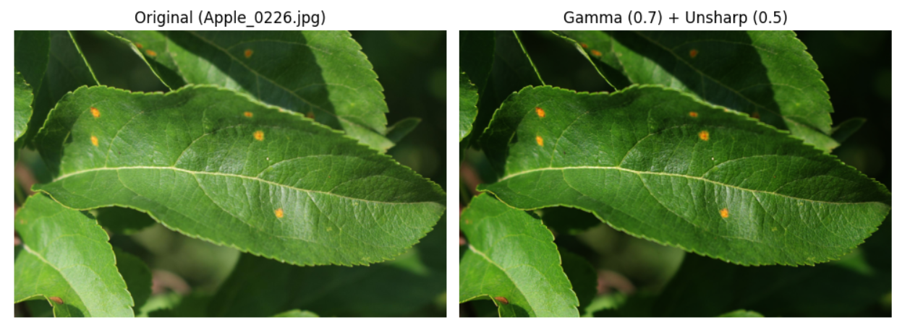
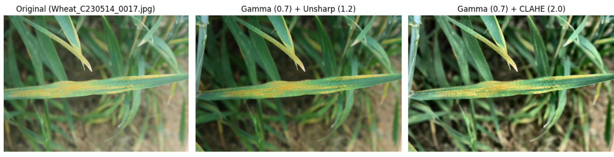

# image-project-Field-PDD
### Classical Image Processing Pipeline for Field-PDD Leaf Lesion Quantification

## Problem Statement & Dataset

Using the Field-PDD dataset of real-world leaf images with pixel-level ground-truth masks, this project builds a classical image-processing pipeline to segment diseased regions and measure lesion area and infection ratio.

Real-world field images may suffer from practical visual issues, including uneven illumination or glare, low contrast, blur and varying sharpness, noise, and holes, gaps, or touching regions after thresholding. These challenges make a single global threshold or a single filter insufficient for reliable segmentation.

## Target User & Task

**Target Users:** Agronomists and crop monitoring engineers.

**Task:** Given an RGB field image of a plant leaf, the system aims to output a cleaned binary lesion mask (`0/1`) and quantify the lesion area and infection ratio.

## Primary Metric

**Intersection over Union (IoU)** between the predicted lesion mask and the pixel-level ground truth.

IoU is the primary evaluation metric because both missed lesions (false negatives) and false detections (false positives) affect segmentation quality and disease severity estimates.

## Dataset

**Field-PDD:** 240 real-world leaf images with pixel-level ground-truth masks.


- **Source:**
https://www.kaggle.com/datasets/alexzcheny/testdataset
- **Licence:**
  [CC BY-NC 4.0](https://creativecommons.org/licenses/by-nc/4.0/)

## Results Table

The following table compares the performance of the two baseline methods and the three proposed processing pipelines on the Development (Dev) and Test datasets.

Results will be updated after completing the implementation and running the evaluation script.

| Method / Pipeline | Split | Mean IoU | PSNR | MSE | Lesion Area / Infection Ratio Error |
|---|---|---|---|---|---|
| Trivial Baseline | Dev | TBD | N/A | N/A | TBD |
| Trivial Baseline | Test | TBD | N/A | N/A | TBD |
| Simple Baseline | Dev | TBD | N/A | N/A | TBD |
| Simple Baseline | Test | TBD | N/A | N/A | TBD |
| Pipeline A | Dev | TBD | TBD | TBD | TBD |
| Pipeline A | Test | TBD | TBD | TBD | TBD |
| Pipeline B | Dev | TBD | TBD | TBD | TBD |
| Pipeline B | Test | TBD | TBD | TBD | TBD |
| Pipeline C | Dev | TBD | TBD | TBD | TBD |
| Pipeline C | Test | TBD | TBD | TBD | TBD |

*Note: PSNR and MSE are applicable only when image restoration quality is evaluated against a suitable reference image.*

## Pipeline Components

The following table summarizes the main components of the baselines and proposed pipelines. The final methods should match the actual implementation.

| Method | Enhancement | Restoration | Segmentation | Morphology | Measurement |
|---|---|---|---|---|---|
| Trivial Baseline | None | None | Global Threshold (127) | None | Pixel Count |
| Simple Baseline | None | None | Otsu Thresholding | 3×3 Opening | Pixel Count |
| Pipeline A | Gamma Correction / Histogram Equalization | None | Global / Otsu Thresholding | None | Pixel Count |
| Pipeline B | Gamma Correction / Histogram Equalization | Median / Gaussian Filtering | Adaptive Thresholding / Edge Detection | None | Pixel Count |
| Pipeline C | Enhancement from Pipeline B | Noise Removal | Adaptive / Edge-based Segmentation | Opening, Closing, Hole Filling | Connected Components / Area Filtering |


- **Degradation & Restoration (`src/data.py`, `src/restoration.py`):** Controlled noise generation (`degrade_image`) and 3x3 median filtering in NumPy (`median_numpy_3x3`).
- **Frequency Analysis (`src/frequency.py`):** Centred Fourier log-magnitude spectrum (`centred_spectrum`) and 2D Gaussian low-pass filter (`gaussian_lpf`).

## Segmentation Baselines (Checkpoint 2)

NumPy thresholding implementations, baseline segmentation methods, IoU evaluation, and CSV experiment logging for the segmentation work package.

### Input & Output Conventions

- **Input images:** Non-empty **2D `uint8`** grayscale arrays (`0..255`).
- **Output masks:** Binary `uint8` arrays (`0` or `1`, where `1` is foreground).
- **Foreground polarity (`foreground`):**
  - `"bright"` (default): pixels strictly greater than threshold (`> T`).
  - `"dark"`: pixels less than or equal to threshold (`<= T`).

### Key Functions

- `validate_image(image)` & `check_foreground(foreground)`: Input validation helpers.
- `global_threshold(image, threshold=127, foreground="bright")`: Fixed global thresholding (`0..255`).
- `otsu_threshold(image)`: Between-class variance maximization in NumPy (returns integer threshold `0..255`).
- `verify_otsu(image)`: Compares NumPy Otsu threshold and binary mask against `cv2.threshold(..., THRESH_OTSU)`.
- `trivial_baseline(image, foreground="bright")`: Fixed threshold `T = 127`.
- `simple_baseline(image, foreground="bright")`: Otsu thresholding followed by a `3x3` morphological opening (`cv2.MORPH_OPEN`).
- `iou(pred, truth)`: Computes Intersection over Union between two binary masks (returns `1.0` if both masks are empty).
- `log_run(path, row)` & `measure_baselines(...)`: Evaluates both baselines on the **development** set and appends runs to a CSV file using `LOG_FIELDS`.

### Self-Check & Usage

Run the built-in verification checks:

bash
python segmentation.py '''


## Image Enhancement Experiments & Results

Our standardized enhancement pipeline applies **Gamma Correction (`gamma = 0.7`)** followed by **CLAHE** on the **L channel** in `LAB` color space (`clipLimit = 2.0`, `tileGridSize = (8, 8)`) to lift shadow/illumination regions and improve local contrast while preserving leaf color fidelity.

### 1. Gamma (`0.7`) + CLAHE (`L`-channel, `clipLimit = 2.0`)+unsharpe


### 2. Gamma (`0.7`) + CLAHE (`L`-channel, `clipLimit = 2.0`)+unsharpe


### 3. Filters Comparison vs. Original (`Laplacian`)


### 4 . Filters Comparison vs. Original ( `High-pass`)


### 5 . Synthetic Salt-and-Pepper Noise Experiment


## Setup and Run Instructions

### 1. Clone the Repository

```bash

git clone https://github.com/lorianca/image-project-.git
cd image-project-
```

### 2. Create a Virtual Environment

```bash
python -m venv venv
```

### 3. Activate the Virtual Environment

**Windows:**

```bash
venv\Scripts\activate
```

**Linux / macOS:**

```bash
source venv/bin/activate
```

### 4. Install Dependencies

```bash
pip install -r requirements.txt
```

### 5. Run the Evaluation

```bash
python src/evaluate.py
```

## Team Roles & Responsibilities

- **Tech Lead ():** Problem formulation, repository structure, integration, code review, final pipeline selection (`config` file, `pipeline.py`, merges), and running the final pipeline across 3 noise levels and 3 seeds with the final results table. 
- **Data and Baseline Engineer ( Zina Ashraf Abdelfatah):** Image loading, dataset splitting, ground truth, controlled degradation, evaluation metrics, and baselines (`data.py`, `metrics.py`, baseline scripts), including resolution/gray-level studies and comparing Pipeline A with baselines.
- **Enhancement Engineer ( Lorianca Makram ):** Histogram analysis, point transformations, histogram equalization, smoothing and sharpening filters (`enhancement.py`), enhancement comparisons, and kernel-size studies.
- **Restoration and Frequency Engineer (Ahmed Mohamed Abd Al Halim):** Noise models, spatial restoration filters, DFT, and frequency-domain filters (`restoration.py`, `frequency.py`), including PSNR per noise type and spatial vs. frequency ablation.
- **Segmentation Engineer (Ahmed Ossama Hassan):** Edge, point, and line detection, thresholding, and edge linking or Hough transform (`segmentation.py`), including detector and threshold-method studies.
- **Morphology and Evaluation Engineer (Sara Mohamed Maher ):** Morphological refinement, lesion measurement, test-set evaluation, failure analysis, and demo (`morphology.py`, `evaluate.py`, `run_pipeline.py`, demo app), including structuring-element studies and failure-case analysis per pipeline.
 ده القديم 
